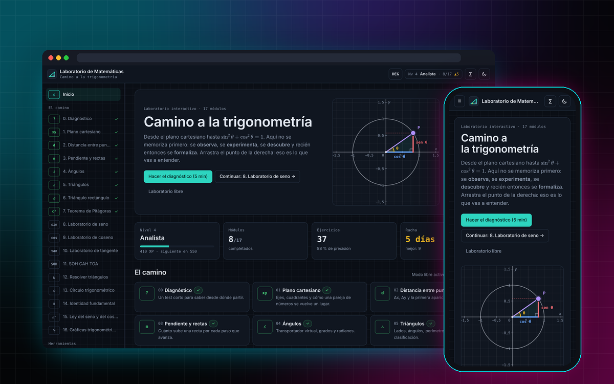

# 🔬 Laboratorio de Matemáticas — Camino a la Trigonometría




Laboratorio interactivo para aprender trigonometría **desde cero**: del plano cartesiano a la ley del coseno y las gráficas de funciones. No es una página con texto: el estudiante arrastra puntos, cambia ángulos, registra mediciones y descubre las relaciones antes de ver la fórmula (**observar → experimentar → descubrir → formalizar**).

🌐 **Demo en vivo:** https://emilianost95-gif.github.io/laboratorio-trigonometria/

---

## ✨ Características

- **21 módulos** (0–20): diagnóstico, plano cartesiano, distancia, pendiente, ángulos, triángulos, triángulo rectángulo, Pitágoras (con demostración animada), seno, coseno, tangente, SOH CAH TOA, resolución de triángulos, círculo unitario, identidad fundamental, **ley del seno y del coseno (con caso ambiguo)**, **gráficas trigonométricas**, **suma de ángulos**, **funciones inversas**, **ecuaciones trigonométricas** y **ángulo doble y mitad** (con un lanzador de proyectiles).
- Cada módulo con 3 vistas: **Laboratorio** interactivo, **Modo profesor** (qué significa, por qué funciona, visualización, fórmula, ejemplo, experimento, ejercicios, desafío) y **Práctica**.
- **Generador procedural** de ejercicios: 20 categorías × 5 niveles, números distintos cada vez.
- **Detector de errores**: compara la respuesta con los errores típicos (seno↔coseno, grados/radianes, Pitágoras al revés, signos, despejes) y explica qué pasó antes de mostrar la solución.
- **Laboratorio libre** con todo conectado: ángulo → seno/coseno → triángulo → pendiente → tangente → ondas.
- **Modo examen** (sin pistas, nota 1,0–7,0 y revisión al final), calculadora científica **DEG/RAD**, cuaderno de laboratorio con fórmulas, progreso con XP, niveles y racha.
- Modo claro/oscuro, responsive (celular, tablet, notebook), accesible con teclado.
- Movimiento con intención: transiciones solo con `transform`/`opacity`, curvas propias, animaciones independientes de los Hz del monitor y respeto de `prefers-reduced-motion`.
- Todo se guarda en el navegador (localStorage versionado y tolerante a datos corruptos).

## 🛠️ Stack

| Capa | Tecnología |
|---|---|
| UI | React 18 + TypeScript |
| Build | Vite 5 (+ `vite-plugin-singlefile` para un único `index.html`) |
| Estilos | Tailwind CSS 3 con tokens de color en variables CSS (tema claro/oscuro) |
| Fórmulas | KaTeX |
| Gráficos | SVG propio (plano cartesiano reutilizable con puntos arrastrables) |
| Pruebas | Vitest (matemática) + Playwright (end-to-end) |

## 🚀 Usarlo

**Sin instalar nada:** abre `docs/index.html` con doble clic. Es la app completa en un solo archivo.

**Para programar** (necesitas [Node.js LTS](https://nodejs.org/) instalado en Windows):

```bash
npm install
npm run dev          # abre http://localhost:5173
npm test             # pruebas de la matemática
npm run build:docs   # regenera docs/index.html después de cambiar el código
```

## 🌍 Publicarlo en GitHub Pages (desde el navegador)

1. En GitHub: **New repository** → nombre `laboratorio-trigonometria` → público → *Create*.
2. En el repo vacío: **Add file → Upload files** y arrastra **el contenido** de esta carpeta (sin `node_modules` si existiera). Commit.
3. **Settings → Pages** → *Source: Deploy from a branch* → Branch `main`, carpeta **`/docs`** → *Save*.
4. En 1–2 minutos queda en `https://emilianost95-gif.github.io/laboratorio-trigonometria/`.

> Cada vez que cambies el código: `npm run build:docs` y vuelve a subir `docs/index.html` (con **Upload files**, no "Create new file").

## 🧱 Arquitectura

```
src/
  math/            funciones puras: trig (valores exactos), geometry, solver (rectángulos),
                   oblique (ley del seno/coseno, caso ambiguo), trigeq (ecuaciones f(Bx) = k),
                   calculator (parser sin eval)
  modules/         generators (ejercicios), checker (diagnóstico de errores), labs/ (21 módulos)
  visualizations/  Plane (plano SVG + primitivas), Curve, RightTriangleView, UnitCircle, MiniFigure
  components/      ui, Tex (KaTeX), ProblemCard, Practice, TeacherMode, Calculator, Layout
  pages/           Home, ModulePage, Diagnostic, FreeLab, Challenges, Notebook, Progress
  data/            módulos, contenido del modo profesor, diagnóstico
  services/        storage (localStorage versionado + respaldo)
  store/           estado global, progreso, niveles, desbloqueo
tests/             math.test.ts (unitarias) · e2e.py (Playwright)
docs/              build autocontenido para GitHub Pages
```

## ✅ Calidad verificada

- `sin²θ + cos²θ = 1` comprobado en 10 000 ángulos al azar (error máximo ≈ 1e-16).
- Solucionadores probados con **todas** las combinaciones de datos (rectángulos y oblicuángulos, incluido el caso ambiguo con 0, 1 y 2 soluciones).
- 4 000 ejercicios generados por prueba: la respuesta correcta siempre se acepta y ningún "error típico" coincide con ella.
- Ecuaciones trigonométricas: cada solución de `f(Bx) = k` se verifica sustituyéndola, para las tres funciones y `B` de 1 a 4.
- Modo examen con nota en escala 1,0–7,0 y revisión de errores.
- Pruebas end-to-end (`tests/e2e.py`, Playwright): todas las rutas y pestañas, arrastre, calculadora DEG/RAD, persistencia, recuperación de datos corruptos, sin desborde horizontal en 390/820/1280 px.

## 🔒 Seguridad

- Sin backend, sin cuentas y sin peticiones de red: todo vive en el navegador.
- El build incluye una **Content-Security-Policy** (`connect-src 'none'`, sin `eval`, sin objetos ni formularios externos).
- Las notas y los respaldos importados se **validan campo por campo**; un respaldo dañado no puede dejar la app inutilizable.
- Las fórmulas se renderizan con KaTeX en modo no confiable (`trust: false`) y el texto se escapa siempre.
- `npm audit --omit=dev` reporta 0 vulnerabilidades en lo que se publica.

## 📚 Aprendizajes

- Diseñar un motor de ejercicios que no solo corrige sino que **explica el error**.
- Visualizaciones SVG con escala real y texto de tamaño constante en cualquier pantalla.
- Separar la matemática en funciones puras para poder probarla a fondo.
- Pedagogía aplicada: el estudiante descubre la regla antes de leerla.

## 👤 Autor

**Emiliano Santo Tomás** — desarrollador front-end
[Portafolio](https://emilianost95-gif.github.io/Portafolio-Emiliano-Santo-Tom%C3%A1s/) · [LinkedIn](https://www.linkedin.com/in/emiliano-santo-tom%C3%A1s-718489291) · [GitHub](https://github.com/emilianost95-gif)
